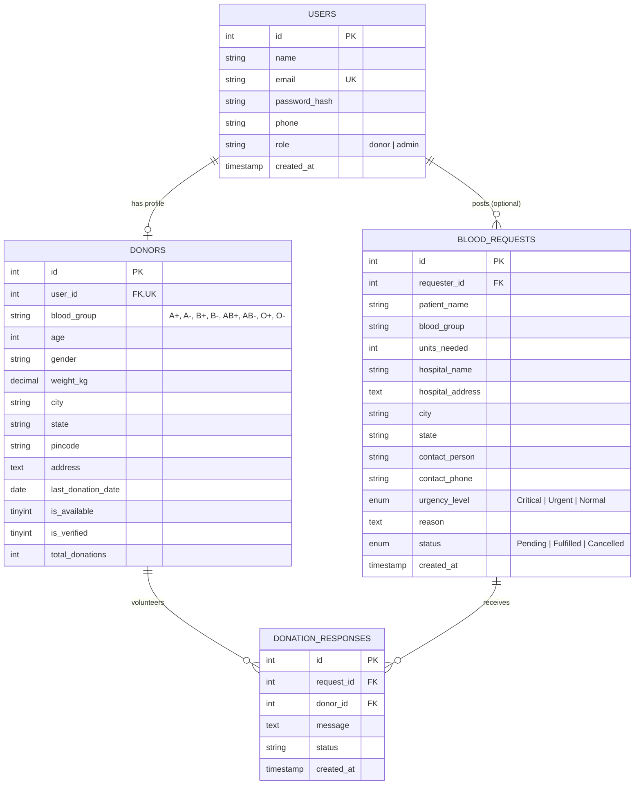

# LifeStream - Blood Donor Finder & Emergency Transfusion Management Portal
> **Computer Science & Engineering (CSE) 2nd Year Mini Project**  
> **Course:** Database Management Systems (DBMS) & Web Technologies  
> **Stack:** HTML5, CSS3, JavaScript | Python (Flask) | MySQL | Visual Studio Code (VS Code)

---

## 📌 1. Project Specifications

| Component | Technology | Purpose in Project |
| :--- | :--- | :--- |
| **Frontend** | **HTML5, CSS3, JavaScript** | Semantic structure, custom responsive design, modal dialogs, and real-time form validation. |
| **Backend** | **Python (Flask)** | Lightweight, clean MVC architecture, RESTful routing, and biological compatibility logic. |
| **Database** | **MySQL (5.7 / 8.0 / MariaDB)** | Relational database with Foreign Keys, indexed searches, and ACID transactions. |
| **Development Tool** | **Visual Studio Code (VS Code)** | Pre-configured `.vscode` launch configurations, Jinja2 syntax support, and terminal debugging. |
| **Security** | **Werkzeug Security** | Salted cryptographic password hashing (SHA-256/scrypt). |

---

## 🎯 2. Core Functional Modules

1. **Donor Registration & Medical Clearance**:
   - Validates donor eligibility (Age 18–65, weight $\ge 45\text{ kg}$).
   - **90-Day Medical Cooldown**: Automatically prevents donations within 90 days of the last donation, displaying a live countdown in the donor dashboard.
2. **Smart Donor Search with Compatibility**:
   - Filter by Blood Group, City, and State.
   - **Biological Compatibility Matching**: Patients can filter not only their exact blood group, but all compatible groups (e.g. $A+$ can receive from $A+, A-, O+, O-$; $O-$ gives to everyone).
   - One-click click-to-call and WhatsApp message triggers.
3. **Emergency Blood Requests Board**:
   - Hospital / patient emergency appeals with urgency levels (*Critical*, *Urgent*, *Normal*).
   - **Automated Proximity Matcher**: Instantly calculates and displays matching donors registered in the same city.
   - Donors can click "I Volunteer to Donate" to pledge transfusions.
4. **Administrator Dashboard**:
   - Visual analytics: Total donors, available donors, pending requests, and blood group distribution bar chart (Chart.js).
   - Donor management: Verify donors, toggle availability, or delete spam profiles.
   - Emergency appeals management: Approve, fulfill, or resolve requests.
5. **Database Management System (DBMS Console)**:
   - Live table browser (`users`, `donors`, `blood_requests`, `donation_responses`).
   - Interactive SQL query console for running read-only queries live during college viva.
   - 1-click database export and re-seed utility.

---

## 🗄️ 3. MySQL Database Schema

The complete MySQL dump file is provided in [`database_mysql.sql`](database_mysql.sql).

### Entity Relationship Diagram:



---

## 💻 4. Running the Project in Visual Studio Code (VS Code)

### Step 1: Open the Project in VS Code
1. Open **Visual Studio Code**.
2. Click **File** -> **Open Folder...**
3. Select `C:\Users\Rohit Singh\.gemini\antigravity\scratch\blood_donor_finder`.

### Step 2: Configure MySQL (XAMPP or MySQL Server)
Make sure your MySQL server is running.
- **If using XAMPP**: Open XAMPP Control Panel and click **Start** next to **MySQL**.
- Default settings in [`config.py`](config.py) match XAMPP (`host: localhost`, `user: root`, `password: ''`, `database: blood_bank_db`).

#### Option A: Automatic Setup Script
Run in VS Code Terminal:
```bash
python setup_mysql.py
```
This script will automatically connect to MySQL, create `blood_bank_db`, create all 4 tables, and seed realistic demo records!

#### Option B: Manual Import via phpMyAdmin / MySQL Workbench
1. Open [http://localhost/phpmyadmin](http://localhost/phpmyadmin).
2. Click **New** -> Create database named `blood_bank_db`.
3. Click the **Import** tab.
4. Choose the file [`database_mysql.sql`](database_mysql.sql) and click **Go**.

### Step 3: Run the Application
You have two easy ways to run the project in VS Code:
- **Method 1 (Press F5)**: Press `F5` on your keyboard. The pre-configured [`.vscode/launch.json`](.vscode/launch.json) will start the Flask server in debug mode with hot-reloading!
- **Method 2 (Terminal)**:
  ```powershell
  python app.py
  ```

### Step 4: Access the Web Portal
Open your browser and navigate to:
```
http://127.0.0.1:5000/
```

*(Note: If MySQL is not running on your machine, the application will automatically activate its local SQLite engine as a fallback so the app never crashes!)*

---

## 🔑 5. Demo Credentials for Viva & Presentation

| Role | Email | Password | Access Details |
| :--- | :--- | :--- | :--- |
| **System Admin** | `admin@bloodfinder.com` | `admin123` | Full Admin Module, Donors Table, SQL Console, Analytics |
| **Voluntary Donor** | `aarav.sharma@example.com` | `donor123` | Donor Dashboard, Cooldown Status, Emergency Volunteer Actions |

*(Tip: On the [Login Page](http://127.0.0.1:5000/login), click the **"Quick Demo Login"** buttons to auto-populate credentials in 1 click!)*

---

## 🎓 6. Academic Viva / Presentation Questions & Answers

### Q1: Why use MySQL for this application?
> **Answer:** MySQL is a high-performance, industry-standard relational DBMS. It supports multi-user concurrency, strict foreign key constraints (`ON DELETE CASCADE`), indexes on `blood_group` and `city` for sub-millisecond lookups, and ACID compliance to prevent race conditions during simultaneous blood requests.

### Q2: How does the blood compatibility algorithm work in SQL?
> **Answer:** Blood compatibility is governed by antigen-antibody reactions. In Python and SQL:
> - An emergency request for $A+$ queries donors with `blood_group IN ('A+', 'A-', 'O+', 'O-')`.
> - An emergency request for $O-$ strictly queries `blood_group = 'O-'` because $O-$ recipients can only receive $O-$ red blood cells.
> - A universal donor with $O-$ can respond to all 8 blood groups.

### Q3: How do you handle password security in Flask?
> **Answer:** We use `werkzeug.security.generate_password_hash` which generates a salted scrypt hash. Plaintext passwords never touch the database.

### Q4: How is the 90-day cooldown period calculated?
> **Answer:** Medical regulations require a minimum 90-day gap between whole blood donations. The system computes `(date.today() - donor.last_donation_date).days`. If $< 90$, `is_available` is set to $0$ (Resting/Cooldown), hiding the donor from immediate emergency calls.
